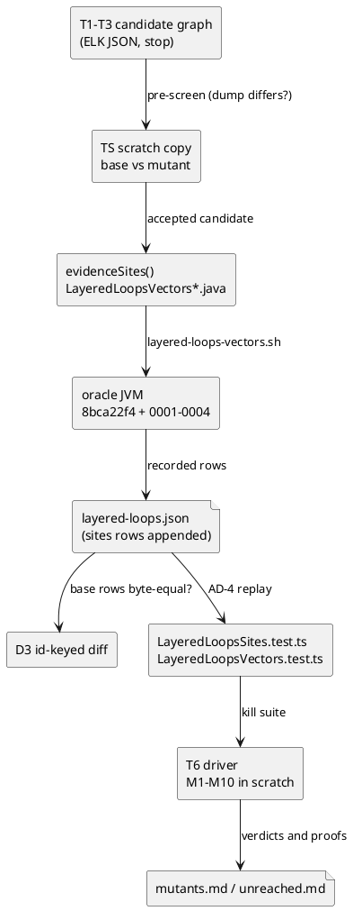

<!-- SPDX-License-Identifier: EPL-2.0 -->

# layered-loops-evidence: data flow

How a candidate graph becomes evidence. Only the oracle run produces expected values (AD-13). The TS pre-screen only
decides which candidates are worth recording.

