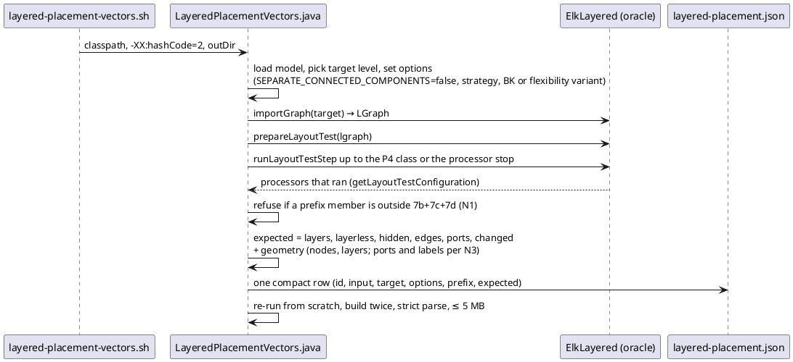
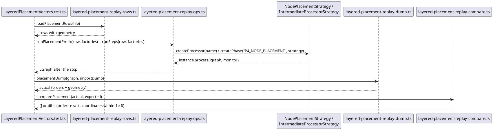
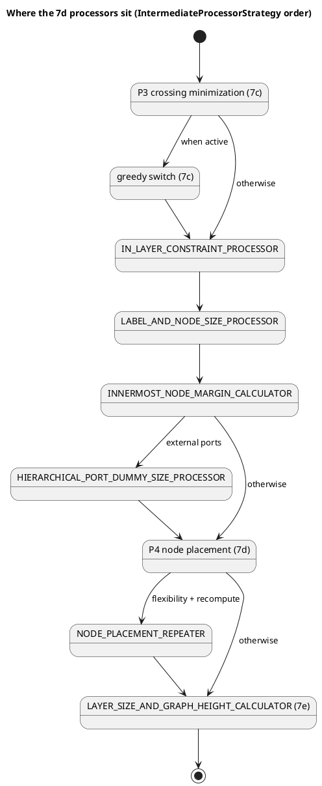

<!-- SPDX-License-Identifier: EPL-2.0 -->

# Data flow — layered-node-placement (mission 7d)

## Recording a pipeline row at the P4 stop (T1)

## Replaying a row in TypeScript (T3, T8)

## The 7d processors around phase 4 (default pipeline)

