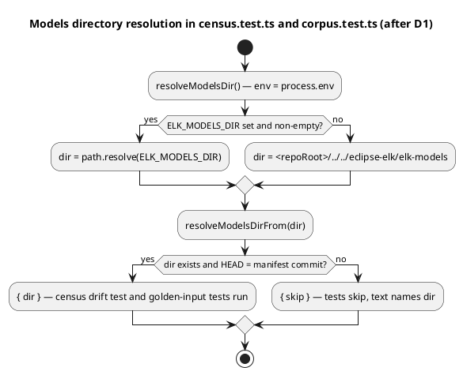

<!-- SPDX-License-Identifier: EPL-2.0 -->

# Data flow: models-dir-env

How the two test files find the models directory after D1. Before: both passed `{}`, so the override branch was never
taken.

