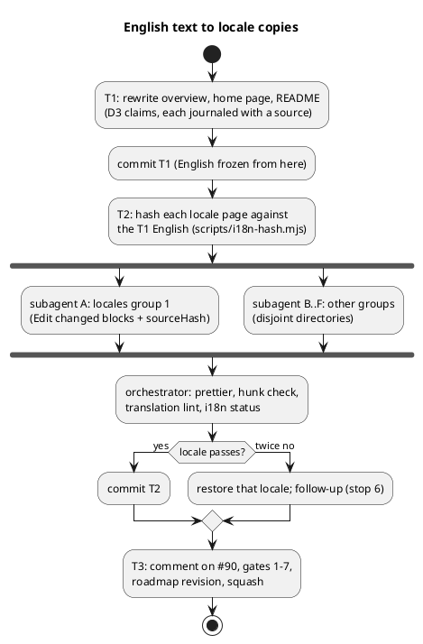

<!-- SPDX-License-Identifier: EPL-2.0 -->

# Data flow: overview-status

No runtime data flow changes: the mission edits documentation prose. The flow below is the executor's path from the
English text to the locale copies, and why the hashes must come after the T1 commit.

