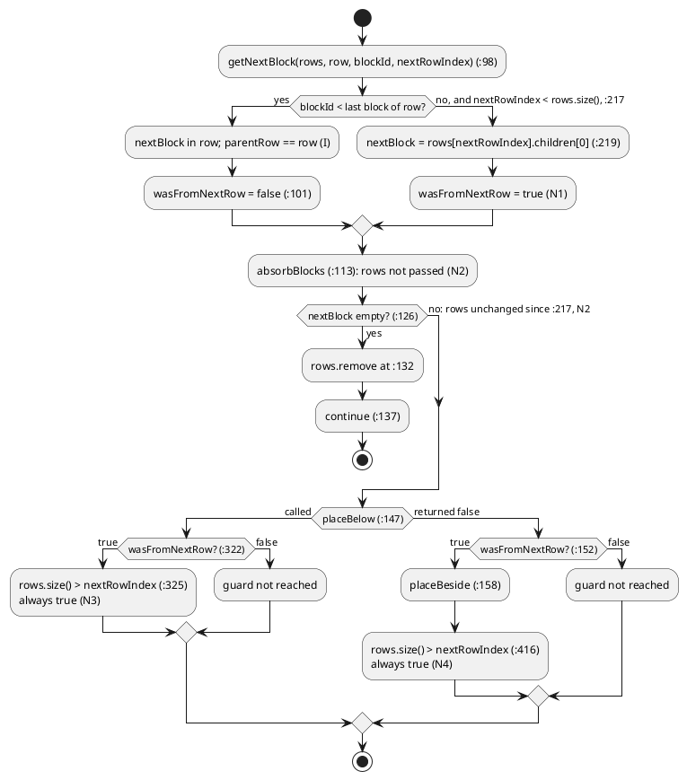

<!-- SPDX-License-Identifier: EPL-2.0 -->

# Data flow: how control reaches the next-row guards (planning hypothesis, D1)

The lemmas of D1 along one pass of `Compaction.compact` at `8bca22f4`. T1 proves or breaks each edge.

