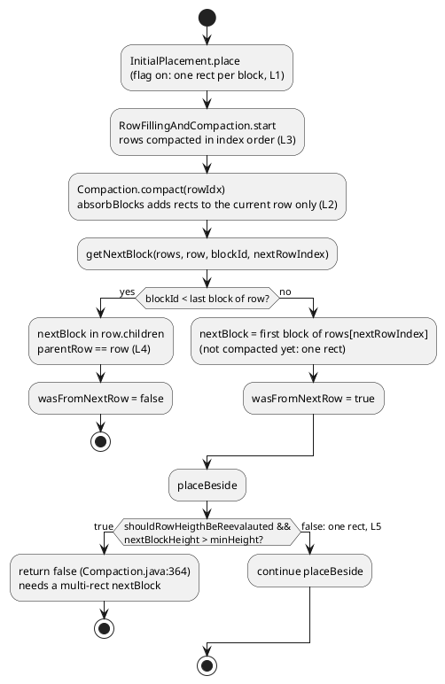

<!-- SPDX-License-Identifier: EPL-2.0 -->

# Data flow: how a block reaches `placeBeside` (planning hypothesis, D1)

The lemmas of D1 along the path a `nextBlock` takes at `8bca22f4`. T1 proves or breaks each edge.

