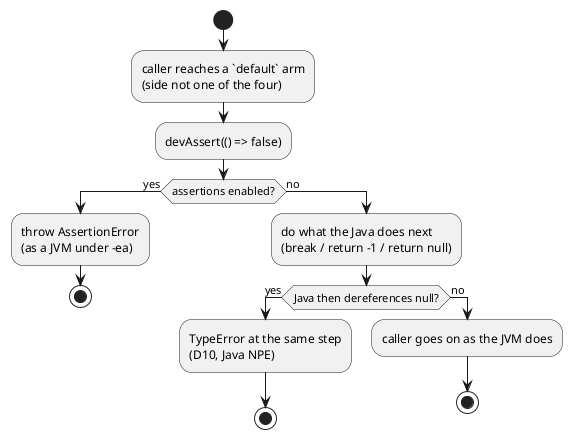

<!-- SPDX-License-Identifier: EPL-2.0 -->

# Data flow: an assert-false arm with assertions off (proposed)

The flow below is the same for each of the six rows. Rows 100 and 108 return null. Rows 99 and 105 then pass the null
on, where the Java dereferences it (D3).

Row 105's null selector never reaches `default`. A Java `switch` on a null enum throws before any arm, so the port
raises the `TypeError` at the `switch` (D3).
