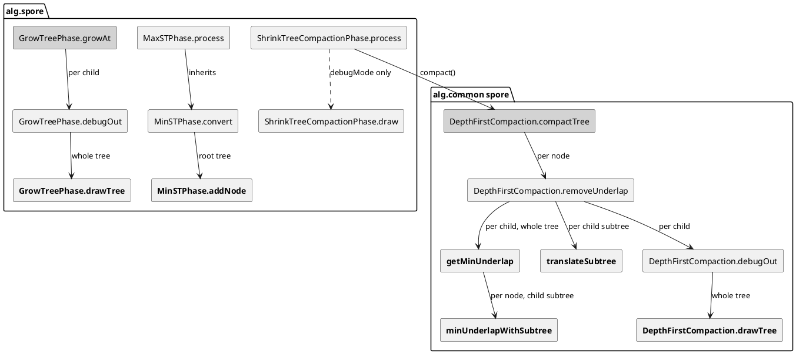

<!-- SPDX-License-Identifier: EPL-2.0 -->

# Component map: the six walks and their callers

Grey: converted by PK6 (no change here). Bold: converted by this mission. Dashed: debug mode only, stays verbatim (D2).

