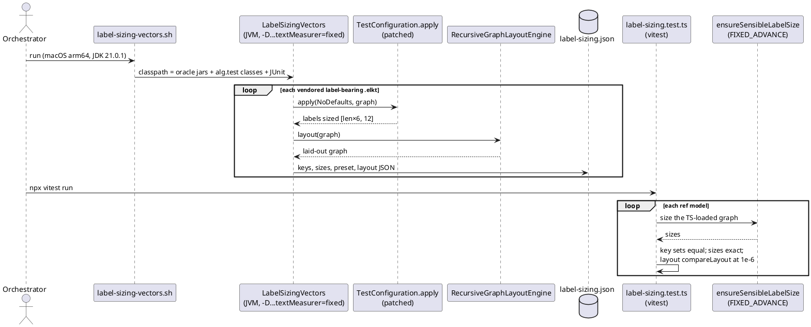

<!-- SPDX-License-Identifier: EPL-2.0 -->

# Data flow: fixed-mode comparison of label-bearing models (proposed)

How the oracle's sizes and layouts become the expected values of the TS comparison (TX6).

