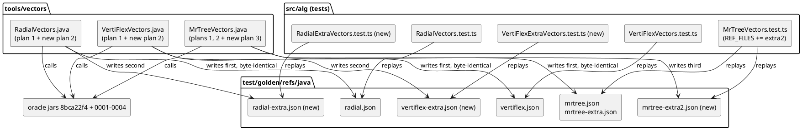

<!-- SPDX-License-Identifier: EPL-2.0 -->

# Component map: tree-recorder-gaps

The new outputs, and what reads them. The five landed refs and their tests are unchanged, apart from the `REF_FILES` append.

